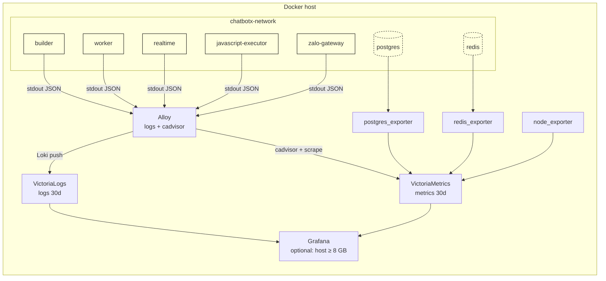

# Self-host telemetry & log monitoring cho ChatbotX (nhẹ)

**Ngày nghiên cứu:** 2026-11-24
**Phạm vi:** hạ tầng Docker Compose của ChatbotX (builder, worker, realtime, javascript-executor, zalo gateway, Postgres/Timescale, Redis, RustFS). Không bao gồm tracing phân tán hay APM per-request.
**Kết luận ngắn (host 4 vCPU / 4 GB):** dùng **Grafana Alloy + VictoriaMetrics + VictoriaLogs, không Grafana** — ~300–400 MB, UI dùng vmui có sẵn. Sentry **self-host không rẻ** (16 GB RAM tối thiểu, 53 service); nếu cần bắt exception thì dùng **Sentry SaaS free** (0 MB, 5k error/tháng) hoặc Bugsink (~700 MB, 1 container) — xem mục 11.
Nếu host ≥ 8 GB mới nên thêm Grafana (dashboard + alert hợp nhất) và 3 exporter; khi đó tổng 350–700 MB.

---

## 1. Hiện trạng trong repo (bằng chứng)

| Hạng mục | Thực tế | Nguồn |
|---|---|---|
| Logger | `pino` ghi **JSON ra stdout**, không có transport/HTTP sink | `packages/logger/src/index.ts` |
| Level | `LOG_LEVEL` (mặc định `info` trong code) và `LOG_DEBUG` | `packages/logger/src/index.ts`, `.env.example:343` |
| Dev mặc định | `.env.example` đặt `LOG_LEVEL=debug` | `.env.example:343` |
| Metrics endpoint | **Không có** `/metrics`, không có `prom-client`, không có OpenTelemetry | grep toàn repo (chỉ có `transport:` của oRPC/voip, không liên quan) |
| Health | `GET /api/health` (builder) trả JSON tĩnh; js-executor/zalo gateway có `/health` | `apps/builder/src/app/api/health/route.ts`, `infas/docker-compose.prod.yml` |
| Structured metric events | Worker/realtime **đã phát log dạng metric** | `apps/worker/src/lib/heavy-metrics.ts:17` ("until the deployment has a metrics exporter"), `apps/realtime/src/lib/realtime-metrics.ts` |
| Queue | 19 BullMQ queue (`integration`, `chat`, `aiAgent`, `heavy`, `webhook`, …) | `packages/worker-config/src/lib/types.ts:3` |
| Deploy | 1 compose dev (`docker-compose.yml`), 1 compose prod (`infas/docker-compose.prod.yml`), healthcheck bằng `curl` | `infas/docker-compose.prod.yml` |
| Log rotation | **Không cấu hình** `logging:` / `daemon.json` → json-file tăng vô hạn | grep compose |

Hệ quả: chỉ cần một agent đọc log Docker + scrape metric hạ tầng là có ngay giá trị; muốn metric nghiệp vụ (webhook fail, queue depth, AI latency) thì phải sửa code (phase 2, mục 6).

---

## 2. Kiến trúc đề xuất



- **Alloy** là agent duy nhất: tail log container qua Docker API, tự chạy `prometheus.exporter.cadvisor` (không cần container cAdvisor riêng), scrape exporter tĩnh, remote-write vào VictoriaMetrics, push log vào VictoriaLogs qua API Loki.
- **VictoriaMetrics single-node**: một process, PromQL-compatible, tự scrape chính nó và nhận remote-write; UI tại `:8428/vmui`.
- **VictoriaLogs single-node**: nhận Loki/Elasticsearch/OTLP/JSON-line; UI tại `:9428/select/vmui/`; không index toàn văn kiểu ES nên nén ~10x và rất nhẹ.
- **Grafana** (tuỳ chọn, chỉ khi host ≥ 8 GB): 2 datasource (Prometheus → VM, VictoriaLogs plugin), alerting hợp nhất. Trên host 4 GB, dùng vmui (`:8428/vmui`, `:9428/select/vmui/`) và `vmalert` nếu cần alert.

### Ngân sách tài nguyên (số liệu tham chiếu, không phải benchmark của repo này)

| Thành phần | RAM điển hình | Ghi chú |
|---|---|---|
| Grafana Alloy | 100–250 MB | Có báo cáo 700 MB và issue memory leak; **cap 256M** ở profile 4 GB (`GOMEMLIMIT=200MiB`) |
| VictoriaMetrics | 40–80 MB | < 35 MB theo blog tham chiếu, tuỳ số series |
| VictoriaLogs | 50–100 MB | ~40 MB ở tải nhỏ |
| Grafana | 120–250 MB | **Bỏ ở profile 4 GB** |
| postgres/redis/node exporter | ~40 MB tổng | Bỏ được; cAdvisor đã có metric hạ tầng cơ bản |
| **Tổng profile 4 GB** | **~250–400 MB** | Alloy + VM + VL, không Grafana, không exporter |
| **Tổng profile ≥ 8 GB** | **~400–700 MB** | Thêm Grafana + 3 exporter |

Profile 4 GB cụ thể: Alloy 256 MB (cap) + VictoriaMetrics 60 MB + VictoriaLogs 80 MB ≈ **400 MB**, cộng disk log nén ~10x. Không thêm container nào khác. Nếu vẫn chật, bỏ Alloy thay bằng **Fluent Bit** (~25–30 MB, tail `/var/lib/docker/containers/*/*-json.log`) + **cAdvisor** (~150 MB) — tổng tương đương nhưng nhiều container hơn; **Vector** (~50–80 MB, Rust) là lựa chọn thay Alloy cho phần log nếu Alloy phình bộ nhớ, đổi lại mất phần cadvisor tích hợp.

Lưu ý: `infas/docker-compose.prod.yml` hiện đặt limit builder 2G + worker 2G + js-executor 512M + zalo 512M. Đó là **limit**, không phải reservation, nhưng trên host 4 GB thì tổng limit đã vượt RAM — cần hạ limit (ví dụ builder/worker 1G) hoặc chấp nhận OOM risk khi tải cao, trước khi thêm bất kỳ thành phần observability nào.

So sánh: SigNoz yêu cầu **≥ 4 GB RAM** cho Docker (ClickHouse + Keeper + Postgres + collector + SigNoz) — không hợp tiêu chí "nhẹ". Loki single-binary ~280–320 MB chỉ cho log, Prometheus thêm 300–500 MB; VM+VL rẻ hơn cho cùng kết quả.

---

## 3. File cấu hình

Đặt trong `infas/observability/`. Dùng dạng **override** để không tạo network mới và không đụng compose prod hiện có.

### 3.1 `infas/docker-compose.observability.yml`

```yaml
# Host 4 GB (Alloy + VM + VL):
#   docker compose -f infas/docker-compose.prod.yml \
#                  -f infas/docker-compose.observability.yml \
#                  --profile observability up -d
# Thêm dashboard (tốn ~200 MB):  --profile observability --profile dashboards
# Thêm postgres/redis/node exporter: --profile observability --profile exporters
x-obs: &obs
  restart: always
  networks: [chatbotx-network]
  profiles: ["observability"]

services:
  alloy:
    <<: *obs
    image: grafana/alloy:v1.22.0
    command:
      - run
      - /etc/alloy/config.alloy
      - --server.http.listen-addr=0.0.0.0:12345
      - --storage.path=/var/lib/alloy/data
    volumes:
      - ./observability/alloy.alloy:/etc/alloy/config.alloy:ro
      - alloy-data:/var/lib/alloy/data
      # Chỉ đọc log/metadata; socket vẫn cho phép gọi API Docker (xem mục 7)
      - /var/run/docker.sock:/var/run/docker.sock:ro
      - /var/lib/docker/containers:/var/lib/docker/containers:ro
    ports:
      - "127.0.0.1:12345:12345"
    environment:
      # Giữ heap dưới cap container; Alloy có issue leak (#1427)
      GOMEMLIMIT: 200MiB
    deploy:
      resources:
        limits:
          memory: 256M

  victoria-metrics:
    <<: *obs
    image: victoriametrics/victoria-metrics:v1.157.0
    command:
      - --storageDataPath=/storage
      - --httpListenAddr=:8428
      - --retentionPeriod=30d
      - --selfScrapeInterval=30s
    volumes:
      - vm-data:/storage
    ports:
      - "127.0.0.1:8428:8428"

  victoria-logs:
    <<: *obs
    image: victoriametrics/victoria-logs:v1.54.0
    command:
      - --storageDataPath=/storage
      - --httpListenAddr=:9428
      - --retentionPeriod=30d
      - --retention.maxDiskSpaceUsageBytes=5GiB
    volumes:
      - vl-data:/storage
    ports:
      - "127.0.0.1:9428:9428"

  grafana:
    <<: *obs
    # Host 4 GB: chỉ bật khi thật cần dashboard, thêm --profile dashboards
    profiles: ["dashboards"]
    image: grafana/grafana:13.2.6
    depends_on: [victoria-metrics, victoria-logs]
    environment:
      GF_SECURITY_ADMIN_PASSWORD: ${GRAFANA_ADMIN_PASSWORD:?GRAFANA_ADMIN_PASSWORD is required}
      GF_PLUGINS_PREINSTALL: victoriametrics-logs-datasource
      GF_USERS_ALLOW_SIGN_UP: "false"
      GF_ANALYTICS_REPORTING_ENABLED: "false"
      GF_ANALYTICS_CHECK_FOR_UPDATES: "false"
    volumes:
      - grafana-data:/var/lib/grafana
      - ./observability/grafana-datasources.yml:/etc/grafana/provisioning/datasources/datasources.yml:ro
    # 3001 vì builder đã dùng 3000
    ports:
      - "127.0.0.1:3001:3000"

  postgres-exporter:
    <<: *obs
    profiles: ["exporters"]
    image: prometheuscommunity/postgres-exporter:v0.21.1
    environment:
      DATA_SOURCE_URI: postgres:5432/${POSTGRES_DB}?sslmode=disable
      DATA_SOURCE_USER: ${POSTGRES_USER}
      DATA_SOURCE_PASS: ${POSTGRES_PASSWORD}

  redis-exporter:
    <<: *obs
    profiles: ["exporters"]
    image: oliver006/redis_exporter:v1.99.0-alpine
    environment:
      REDIS_ADDR: redis://redis:6379

  node-exporter:
    <<: *obs
    profiles: ["exporters"]
    image: prom/node-exporter:v1.11.1
    pid: host
    command: ["--path.rootfs=/host"]
    volumes:
      - /:/host:ro,rslave

volumes:
  alloy-data:
  vm-data:
  vl-data:
  grafana-data:
```

### 3.2 `infas/observability/alloy.alloy`

```alloy
logging {
  level  = "warn"
  format = "logfmt"
}

// ── Metrics ────────────────────────────────────────────────
prometheus.exporter.cadvisor "docker" {
  docker_host      = "unix:///var/run/docker.sock"
  storage_duration = "5m"
}

prometheus.scrape "cadvisor" {
  targets         = prometheus.exporter.cadvisor.docker.targets
  forward_to      = [prometheus.remote_write.metrics.receiver]
  scrape_interval = "30s"
}

prometheus.scrape "exporters" {
  targets = [
    { __address__ = "postgres-exporter:9187", service = "postgres" },
    { __address__ = "redis-exporter:9121",    service = "redis" },
    { __address__ = "node-exporter:9100",     service = "host" },
  ]
  forward_to      = [prometheus.remote_write.metrics.receiver]
  scrape_interval = "30s"
}

prometheus.remote_write "metrics" {
  endpoint {
    url = "http://victoria-metrics:8428/api/v1/write"
  }
}

// ── Logs (stdout/stderr của mọi container) ─────────────────
discovery.docker "containers" {
  host = "unix:///var/run/docker.sock"
}

discovery.relabel "logs" {
  targets = []

  rule {
    source_labels = ["__meta_docker_container_name"]
    regex         = "/(.*)"
    target_label  = "service_name"
  }
  rule {
    source_labels = ["__meta_docker_container_label_com_docker_compose_service"]
    target_label  = "compose_service"
  }
}

loki.source.docker "containers" {
  host          = "unix:///var/run/docker.sock"
  targets       = discovery.docker.containers.targets
  labels        = { platform = "docker" }
  relabel_rules = discovery.relabel.logs.rules
  forward_to    = [loki.process.logs.receiver]
}

// pino chỉ log JSON ở app container; stage.json chạy trong match để log
// Postgres/Redis (không phải JSON) không bị drop.
loki.process "logs" {
  forward_to = [loki.write.victorialogs.receiver]

  stage.match {
    selector = "{service_name=~\"chatbotx.*\"}"

    stage.json {
      expressions = {
        level  = "level",
        module = "module",
      }
    }
    stage.labels {
      values = { level = "", module = "" }
    }
  }
}

loki.write "victorialogs" {
  external_labels = { cluster = "chatbotx" }

  endpoint {
    // _stream_fields giữ số stream nhỏ: chỉ tách theo container
    url = "http://victoria-logs:9428/insert/loki/api/v1/push?_stream_fields=service_name"
  }
}
```

Nếu chạy profile 4 GB (không `exporters`), xoá 3 target `postgres-exporter`/`redis-exporter`/`node-exporter` khỏi `prometheus.scrape.exporters` — nếu không Alloy sẽ liên tục báo target down và sinh metric `up=0`.

### 3.3 `infas/observability/grafana-datasources.yml`

```yaml
apiVersion: 1
datasources:
  - name: VictoriaMetrics
    type: prometheus
    access: proxy
    url: http://victoria-metrics:8428
    isDefault: true
    jsonData:
      prometheusType: Prometheus
      timeInterval: 30s

  - name: VictoriaLogs
    type: victoriametrics-logs-datasource
    access: proxy
    url: http://victoria-logs:9428
```

---

## 4. Thay đổi bắt buộc ngoài compose

1. **Bật log rotation của Docker** (`/etc/docker/daemon.json` + restart docker). Alloy đọc qua Docker API nên file json-file vẫn là nguồn; không xoay vòng thì disk đầy:
   ```json
   { "log-driver": "json-file", "log-opts": { "max-size": "50m", "max-file": "3" } }
   ```
2. **`LOG_LEVEL=info` ở production** (`.env.example` để `debug`). Ở mức `debug`, log webhook/AI tăng vài lần, kéo theo dung lượng VictoriaLogs.
3. **Không publish port observability ra 0.0.0.0**: giữ `127.0.0.1:*` như trên, truy cập qua SSH tunnel hoặc reverse proxy có auth.
4. `GRAFANA_ADMIN_PASSWORD` chỉ cần khi bật `--profile dashboards`; thêm vào `.env` (không commit).

---

## 5. Alert tối thiểu

Host 4 GB không chạy Grafana: dùng **vmalert** (~30–50 MB) + `alertmanager`/webhook trực tiếp (hoặc gửi Telegram qua webhook receiver) cho 5 rule dưới. Nếu bật profile `dashboards`, chuyển các rule này sang Grafana unified alerting.

| Alert | PromQL | Ngưỡng |
|---|---|---|
| Exporter/service chết | `up{job=~".+"} == 0` | for 2m |
| OOM kill | `increase(container_oom_events_total[10m]) > 0` | mọi lần |
| RAM container > 90% limit | `container_memory_working_set_bytes{name!=""} / container_spec_memory_limit_bytes{name!=""} > 0.9` | for 10m |
| Disk < 10% | `node_filesystem_avail_bytes{mountpoint="/"} / node_filesystem_size_bytes{mountpoint="/"} < 0.1` | for 15m (cần profile `exporters`) |
| Restart loop | `increase(container_start_time_seconds[15m]) > 3` | for 0 |
| Postgres/Redis chết | `pg_up == 0 or redis_up == 0` | for 1m (cần profile `exporters`) |

Alert dựa trên **log** (ví dụ `heavy_worker_metric` với `event:failed`) cũng chạy được bằng vmalert trỏ vào VictoriaLogs — để phase 2.

---

## 6. Metric nghiệp vụ (phase 2, cần sửa code)

Hiện có 3 nguồn log-metric đã có sẵn: `heavy_worker_metric`, `realtime_server_metric`, `metric: contacts|botMessages|monthlyBotMessages`. Có 2 cách, chọn 1:

- **Không sửa code:** dashboard VictoriaLogs dùng LogsQL (`* | unpack_json | stats by (event) count()`) để đếm fail/retry. Rẻ nhất, đủ cho vận hành nhỏ.
- **Có sửa code:** thêm route `/metrics` bằng `prom-client` trong builder/worker, expose `BullMQ` job counts (`queue.getJobCounts()`) theo 19 queue và histogram thời gian xử lý. Đây là thay đổi thật trong app, cần tuân invariant 23 (public API trước) nếu muốn agent đọc được.

Không làm ở v1: OpenTelemetry tracing, per-request APM. Chưa có nhu cầu và làm tăng 1 collector + backend traces.

---

## 7. Rủi ro & biện pháp

| Rủi ro | Mức | Biện pháp |
|---|---|---|
| Alloy memory leak (issue #1427), có báo cáo 700 MB | Trung bình | `limits.memory: 256M` + `GOMEMLIMIT=200MiB` + alert RAM; fallback: **Fluent Bit** (~25 MB) tail `/var/lib/docker/containers/*/*-json.log` + container `cadvisor` |
| Host 4 GB đã overcommit limit app (2G builder + 2G worker + …) | Cao | Hạ limit builder/worker xuống 1G trước khi thêm observability; cap observability ở ~400 MB |
| Worker không có HTTP health endpoint (chỉ builder `/api/health`, realtime/js-executor/gateway có `/health`) | Trung bình | Uptime check bên ngoài không phủ worker; dùng alert theo log (`heavy_worker_metric`/restart loop) hoặc thêm health server tối thiểu vào worker ở phase 2 |
| Mount `docker.sock` = quyền root host | Cao | Chỉ mount cho Alloy, không expose Alloy UI ra ngoài, không chạy Alloy bằng user có quyền khác; chấp nhận trade-off của mọi agent Docker |
| Grafana plugin VictoriaLogs cần Internet khi khởi động | Thấp | Pre-pull image + `GF_PLUGINS_PREINSTALL`; môi trường air-gapped phải build image sẵn plugin |
| Log trùng sau restart Alloy | Thấp | Alloy lưu position trong `--storage.path`; nếu trùng, dedupe bằng `_time` khi query |
| Retention 30d làm đầy disk | Trung bình | VictoriaLogs `--retention.maxDiskSpaceUsageBytes=5GiB` là chốt cứng; VictoriaMetrics dùng `--retentionPeriod` + alert disk |
| Log app chứa dữ liệu khách | Trung bình | `packages/logger` đã redact secret; vẫn nên giới hạn quyền đọc Grafana và không bật `LOG_DEBUG` lâu dài |

---

## 8. Rollout (host 4 GB)

1. Hạ limit builder/worker xuống 1G trong `infas/docker-compose.prod.yml`; tạo `infas/observability/alloy.alloy` + file compose như mục 3 (Grafana/exporter để profile riêng).
2. Bật log rotation Docker, đặt `LOG_LEVEL=info`.
3. `docker compose -f infas/docker-compose.prod.yml -f infas/docker-compose.observability.yml --profile observability up -d`
4. Kiểm tra:
   ```bash
   curl -s localhost:8428/api/v1/query --data-urlencode 'query=up' | jq '.data.result[].metric'
   curl -s localhost:9428/select/logsql/query -d 'query=* | limit 5'
   curl -s localhost:12345/-/ready
   docker stats --no-stream --format '{{.Name}}\t{{.MemUsage}}'
   ```
5. Dùng vmui: `http://127.0.0.1:8428/vmui` (metric) và `http://127.0.0.1:9428/select/vmui/` (log). Thêm `vmalert` nếu cần alert; bật `--profile dashboards` chỉ khi còn RAM trống.
6. Sau 1 tuần: đo `docker stats`, chỉnh retention/limit; nếu Alloy chạm cap liên tục, chuyển sang Fluent Bit.

Chưa chạy thử trong môi trường này (không bật stack observability trên máy dev). Cấu hình dựa trên tài liệu chính thức và compose mẫu của VictoriaMetrics/Grafana; bước 4 là kiểm chứng bắt buộc trước khi tin.

---

## 9. Phương án khác và lý do không chọn

| Phương án | Container | RAM | Đánh giá |
|---|---|---|---|
| **Alloy + VM + VL, không Grafana (vmui)** | 3–4 | 250–400 MB | **Profile 4 GB được chọn.** Không dashboard hợp nhất; alert qua `vmalert` |
| **OpenObserve standalone** + Alloy | 2–3 | 600 MB–1 GB (ước tính, chưa verify) | Ít thành phần, có sẵn UI/alert; một binary vừa lưu vừa query, ăn 15–25% RAM host 4 GB |
| **Loki + Prometheus + Grafana + Alloy** | 5 | 900 MB–1.3 GB | Quá nặng cho 4 GB |
| **SigNoz** | 5+ | ≥ 4 GB | Chiếm toàn bộ host — không khả thi |
| **ELK/OpenSearch** | 3+ | ≥ 2 GB | Không khả thi |
| **Grafana Cloud free tier** | 0 | 0 | Không phải self-host (yêu cầu của đề bài) |

---

## 10. Câu hỏi chưa giải quyết

1. ~~Mục tiêu RAM cứng?~~ Đã xác nhận: host 4 vCPU / 4 GB → profile không Grafana ở mục 2.
2. Có cần alerting ngay từ ngày đầu không (webhook fail, AI timeout), hay chỉ cần tra log/metric thủ công? Nếu cần, thêm `vmalert` (~40 MB).
3. Có cần giữ log > 30 ngày cho điều tra sự cố không? Ảnh hưởng trực tiếp disk.
4. Observability chạy cùng host với app hay host riêng? Cùng host thì mất khả năng quan sát khi host chết — cần ít nhất một uptime check bên ngoài (Uptime Kuma hoặc healthcheck từ máy khác); lưu ý worker không có health endpoint.
5. Có cần Sentry (error tracking) hay log pino trong VictoriaLogs là đủ? Xem mục 11.

---

## 11. Sentry có rẻ không?

**Sentry SaaS rẻ; Sentry self-host không rẻ — và không khả thi trên host 4 GB.**

### SaaS (sentry.io, giá 2026)

| Plan | Giá | Error | Logs | Metrics | Ghi chú |
|---|---|---|---|---|---|
| Developer | **$0**, 1 user | 5k error/tháng | 5 GB | 5 GB | Không PAYG → vượt quota là **mất event**, alert chỉ email |
| Team | **$26/tháng** (trả năm) | 50k error | 5 GB | 5 GB | Unlimited user, integrations, 20 dashboard |
| Business | **$80/tháng** | 50k error | 5 GB | 5 GB | SAML/SCIM, quota nâng cao |

Vượt quota: error ~$0.29/1k (Team, 50k–100k) tức ~**$29 cho 100k error**; logs/metrics **$0.50/GB**. Với một sản phẩm chatbot nhỏ, 5k error/tháng thường đủ; nếu không, $26/tháng vẫn rẻ hơn rất nhiều so với chi phí RAM để self-host.

### Self-host

- Yêu cầu chính thức: **16 GB RAM, 4 CPU, 20 GB disk**; thực tế vận hành 24–32 GB mới ổn định.
- Release 26.10.1 có **53 service** trong Compose (Kafka, ClickHouse, Snuba, Postgres, Redis, Relay, worker…), installer từ chối chạy dưới ~14 GB.
- Trên host 4 GB: **không thể**. Kể cả chạy được cũng chiếm toàn bộ máy.

### Thay thế self-host nhẹ (Sentry SDK-compatible)

| | RAM | Thành phần | Đánh giá cho host 4 GB |
|---|---|---|---|
| **Bugsink** | ~700 MB | 1 container (Django + SQLite) | Khả thi về kỹ thuật nhưng chiếm ~18% RAM; không có performance/tracing |
| **GlitchTip** | ~1–1.5 GB | web + worker + Postgres + Redis | Quá nặng cho 4 GB |
| **Sentry self-host** | ≥ 16 GB | 53 service | Không khả thi |

Khuyến nghị: **không self-host Sentry trên host này**. Nếu cần bắt exception có stack trace: dùng **Sentry SaaS Developer ($0)** — chỉ cần thêm `@sentry/nextjs`/`@sentry/node` với DSN, dữ liệu ra ngoài host. Nếu bắt buộc dữ liệu ở lại: dùng **Bugsink** và chấp nhận ~700 MB, hoặc chấp nhận chỉ có log pino trong VictoriaLogs (đã có stack trace trong `err` serializer) — rẻ nhất, 0 MB thêm.

Lưu ý: Sentry là **error tracking**, không thay thế log/metric monitoring ở mục 2; nó bổ sung nhóm lỗi, release/source map, và alert theo issue.

### Nếu chấp nhận gói free (tổng $0)

| Nhu cầu | Gói free đủ? | Điều kiện |
|---|---|---|
| Error tracking (exception, stack trace) | **Đủ nếu 1 người dùng và ≤ 5k error/tháng** (~166/ngày) | Vượt quota là **mất event** (free không có PAYG); alert chỉ qua email |
| Log + metric hạ tầng | **Không** — Sentry không thay thế log/metric | Vẫn cần Alloy + VM + VL self-host (~400 MB) |
| Muốn bỏ luôn VM/VL | Grafana Cloud free: 10k series, 50 GB log, 14 ngày, 3 user | Không còn self-host; Alloy vẫn chạy local (~250 MB) để gửi dữ liệu ra |

> **5k là quota theo chu kỳ tháng**, không phải cửa sổ thời gian ngắn: reset đầu mỗi billing cycle, hết là drop tới hết tháng. Cái "window" bạn có thể nhớ là hai cơ chế khác của Sentry: **Spike Protection** (tự phát hiện spike trong vài phút) và **rate limit theo Client Key** (Project Settings → Client Keys → Configure → *Rate Limits*, ví dụ 5 event/phút). Cả hai chỉ chặn burst — event bị chặn vẫn không tiêu quota, nhưng quota tháng vẫn là giới hạn cứng.

Rủi ro thật của free tier Sentry không phải giá mà là **error storm**: một webhook provider lỗi hàng loạt có thể đốt 5k event trong vài phút rồi im lặng hết tháng. Bắt buộc lọc trước khi gửi:

```ts
// builder (server-side) và worker: @sentry/node; KHÔNG cần browser SDK
Sentry.init({
  dsn: process.env.SENTRY_DSN,
  tracesSampleRate: 0,        // free tier không cần tracing
  sampleRate: 0.5,            // hạ tải khi volume cao; 1.0 nếu còn dư quota
  maxBreadcrumbs: 10,
  ignoreErrors: [/AbortError/, /ECONNRESET/, /rate limit/i],
  beforeSend(event) {
    // Chỉ giữ lỗi thật; lỗi nghiệp vụ đã xử lý thì đừng capture ngay từ đầu
    const type = event.exception?.values?.[0]?.type
    if (type === "ValidationError" || type === "ProviderHttpError") return null
    return event
  },
})
```

Dùng `@sentry/node` server-side, không bật `withSentryConfig`/browser SDK: tránh tăng bundle client và thời gian build trên host 4 GB. Source map upload (nếu cần stack trace dễ đọc) chạy từ CI, không chạy trên host prod.

Theo dõi hàng tuần trong Sentry → Stats; chạm 80% quota thì hoặc siết filter, hoặc nâng Team ($26) — vẫn rẻ hơn RAM để self-host.

### Tổng chi phí

| Hạng mục | $/tháng | RAM host |
|---|---|---|
| Alloy + VictoriaMetrics + VictoriaLogs (self-host) | 0 | ~400 MB |
| Sentry Developer (error tracking) | 0 | 0 |
| **Tổng** | **0** | **~400 MB** |

Chỉ nâng Sentry Team ($26) khi > 5k error/tháng hoặc cần > 1 người dùng; nâng RAM host khi cần thêm Grafana.

---

## 12. Không dùng Alloy: công cụ cơ bản để monitor sản phẩm

### 12.1 Thay Alloy bằng gì (nếu chỉ cần shipper)

| Cách | Container | RAM | Ghi chú |
|---|---|---|---|
| **Fluent Bit** | 1 | ~25–40 MB | Tail `/var/lib/docker/containers/*/*-json.log`, có `node_exporter_metrics` (host) + `prometheus_remote_write`; nhẹ nhất, C |
| **Vector** | 1 | ~50–80 MB | `docker_logs` + `host_metrics` + scrape; cấu hình YAML dễ hơn Fluent Bit, Rust |
| **OTel Collector** | 1 | ~60–100 MB | Chuẩn OTel, nhiều protocol; nặng cấu hình hơn nhu cầu hiện tại |
| **Docker Loki log driver** | 0 | 0 | Plugin `docker plugin install grafana/loki-docker-driver`; chỉ ship được tới backend nhận Loki push (Loki/VictoriaLogs), **không** tới OpenObserve |
| **App push từ pino** | 0 | 0 | `pino-opentelemetry-transport` → OTLP, hoặc transport HTTP tự viết; **cần sửa code** 3 app, chỉ lấy được log của app |

### 12.2 Một công cụ duy nhất để monitor sản phẩm

| Công cụ | Container | RAM | Log | Metric | Alert | Lịch sử | Nhận xét |
|---|---|---|---|---|---|---|---|
| **OpenObserve** (+ Fluent Bit) | 2 | ~210 MB idle, ~250–350 MB thực tế | ✓ | ✓ host | ✓ (scheduled SQL, webhook/email) | ✓ 30 ngày | **Một backend cho log + metric + alert + UI**; đúng nhu cầu "một công cụ" |
| **Beszel** | 2 (hub + agent) | ~50 MB | ✗ | ✓ host + **từng container** | ✓ (nhiều kênh, có Telegram) | ✓ | Nhẹ nhất, cài 5 phút; không có log tập trung |
| **Netdata** | 1 | 100–350 MB | cần OTel Collector; xem log cần tài khoản Netdata Cloud (OTel logs còn cần plan trả phí) | ✓ | ✓ | ✓ | Zero-config nhưng log không self-host trọn vẹn |
| **Dozzle** | 1 | ~15–30 MB | ✓ live tail | ✗ | ✗ | ✗ | Chỉ xem log realtime, không lưu |
| **Uptime Kuma** | 1 | ~100 MB | ✗ | uptime/latency | ✓ | ✓ | Trả lời "sản phẩm còn sống không", không có telemetry |
| **Sentry free** | 0 | 0 | ✗ | ✗ | email | 30 ngày | Chỉ lỗi ứng dụng |

Chọn theo nhu cầu thật:
- **"Sản phẩm còn sống, container nào ăn RAM, có restart/OOM không, alert Telegram"** → **Beszel** (~50 MB). Đây là mức "cơ bản" rẻ nhất và không cần pipeline nào. Log vẫn xem bằng `docker compose logs -f` hoặc Dozzle.
- **"Cần một chỗ để tra log + chart + alert"** → **OpenObserve + Fluent Bit** (~250–350 MB). Không Alloy, không Grafana, không VM/VL.
- Cả hai đều ghép được với **Sentry free** cho lỗi ứng dụng.

### 12.3 OpenObserve + Fluent Bit (không Alloy)

```yaml
# infas/docker-compose.observability.yml (thay cho mục 3 nếu chọn hướng này)
services:
  openobserve:
    image: public.ecr.aws/zinclabs/openobserve:v1.0.4
    restart: always
    networks: [chatbotx-network]
    environment:
      ZO_DATA_DIR: /data
      ZO_COMPACT_DATA_RETENTION_DAYS: "30"   # mặc định 3650 ngày — phải đổi
      ZO_TELEMETRY: "false"                 # tắt telemetry ẩn danh
      ZO_ROOT_USER_EMAIL: ${ZO_ROOT_USER_EMAIL:?}
      ZO_ROOT_USER_PASSWORD: ${ZO_ROOT_USER_PASSWORD:?}  # chỉ đọc lần khởi động đầu
    ports:
      - "127.0.0.1:5080:5080"
    volumes:
      - obs-data:/data
    deploy:
      resources:
        limits:
          memory: 768M

  fluent-bit:
    image: fluent/fluent-bit:5.2.0
    restart: always
    networks: [chatbotx-network]
    volumes:
      - ./observability/fluent-bit.conf:/fluent-bit/etc/fluent-bit.conf:ro
      - /var/lib/docker/containers:/var/lib/docker/containers:ro
      - /proc:/host/proc:ro
      - /sys:/host/sys:ro
    deploy:
      resources:
        limits:
          memory: 128M

volumes:
  obs-data:
```

```ini
# infas/observability/fluent-bit.conf
[SERVICE]
    Flush        5
    Log_Level    warn

# Log của mọi container (Docker json-file)
[INPUT]
    Name              tail
    Path              /var/lib/docker/containers/*/*-json.log
    Parser            docker
    Tag               docker.*
    Refresh_Interval  5
    Skip_Long_Lines   On

# Bóc lớp json-file, rồi parse pino JSON bên trong field "log"
[FILTER]
    Name          parser
    Match         docker.*
    Key_Name      log
    Parser        json
    Reserve_Data  On

[OUTPUT]
    Name          http
    Match         docker.*
    Host          openobserve
    Port          5080
    URI           /api/default/docker/_json
    Format        json
    json_date_key time
    json_date_format iso8601
    HTTP_User     ${ZO_INGEST_USER}
    HTTP_Passwd   ${ZO_INGEST_PASS}

# Metric host: CPU, RAM, disk, network
[INPUT]
    Name              node_exporter_metrics
    Tag               host_metrics
    Scrape_Interval   30
    Path.Procfs       /host/proc
    Path.Sysfs        /host/sys

[OUTPUT]
    Name          prometheus_remote_write
    Match         host_metrics
    Host          openobserve
    Port          5080
    Uri           /api/default/prometheus/api/v1/write
    HTTP_User     ${ZO_INGEST_USER}
    HTTP_Passwd   ${ZO_INGEST_PASS}
```

Lưu ý OpenObserve:
- Pin image theo release hiện tại của bạn (`public.ecr.aws/zinclabs/openobserve:v1.0.4` ở đây lấy từ hướng dẫn đã verify tháng 9/2026; kiểm tra lại tag trước khi deploy).
- Tạo **user riêng cho ingestion** trong UI (đừng dùng root cho shipper).
- Dữ liệu **immutable**: không sửa/xoá từng record, chỉ chờ hết retention → không đẩy secret/PII vào log.
- Metric **từng container**: `node_exporter_metrics` chỉ có host. Fluent Bit `docker` input trả **log record** (`cpu_used`, `mem_used`, `name`) → gửi vào một stream `_json` riêng và query/alerts bằng SQL của OpenObserve; không đi qua `prometheus_remote_write` được.
- Chưa verify end-to-end trên repo này; kiểm tra response `{"successful":N}` ở `POST /api/default/docker/_json` và `docker stats` sau khi chạy.

---

## 13. Reddit: cộng đồng chọn gì cho small project

Đã đọc 7 thread (2025-09 → 2026-10) trên r/sre, r/node, r/VPS, r/selfhosted, r/SelfHosting, r/homelab, r/Observability. Đây là ý kiến cộng đồng, không phải benchmark.

### 13.1 Được nhắc nhiều nhất, theo nhóm nhu cầu

| Nhu cầu | Công cụ được đề xuất lặp lại | Trích dẫn tiêu biểu |
|---|---|---|
| Uptime / "sản phẩm còn sống?" | **Uptime Kuma**, **Gatus** | "Personal projects I just have a Gatus alert if a service goes down" (r/VPS); "Uptime Kuma for anything public facing" (r/homelab) |
| Metric host + container, nhẹ | **Beszel**, Netdata, node_exporter | "Beszel and uptime Kuma ezpz" (r/homelab); "Netdata is nice. Uptime Kuma is heavy but simple" (r/homelab) |
| Log container | **Dozzle** (xem nhanh), **OpenObserve** (lưu + query) | "Dozzle for quick searches, and open observe for still logs, queries and dashboards" (r/selfhosted, comment 29 điểm) |
| Backend log/metric nhẹ | **VictoriaMetrics + VictoriaLogs**, OpenObserve | "VictoriaLogs… single 20MB executable, runs out of the box" (r/selfhosted); "VictoriaLogs and VictoriaMetrics because they don't eat all your RAM" (r/Observability) |
| Stack quen thuộc | Prometheus + Grafana (+ Loki/Alloy) | "Prometheus is really light. I run it on a Raspberry Pi" (r/sre) — ý kiến trái chiều với nhóm "Loki setup painful" |
| Unified APM | SigNoz, Grafana Cloud free | "SigNoz works in small scale pretty well… without a tooling circus" (r/sre) |
| Error tracking | **Sentry (SaaS)**, Better Stack free | "sentry, basic logs from the platform, and maybe a small uptime monitor… big stacks are overkill" (r/node) |
| Kiểu enterprise | Checkmk, Zabbix | "Checkmk, took me 20 mins to set it up" (r/node); "Zabbix templates for everything" (r/homelab) |

### 13.2 Điều cộng đồng lặp lại nhiều hơn cả việc chọn tool

1. **"5 actionable alerts > 50 noisy ones"** (r/VPS, nhiều comment đồng tình). Chỉ alert khi có việc phải làm; thêm time threshold (RAM > 90% trong 10 phút) để giảm nhiễu.
2. **Monitor phải nằm ngoài box bị monitor** — nếu cùng máy chết thì không ai báo. Cần ít nhất một uptime check từ ngoài (Uptime Kuma/Gatus/Better Stack).
3. **"Monitoring không nên trở thành một infra stack thứ hai"** (r/homelab, r/sre). Nhiều người bỏ Prometheus+Loki vì công setup/vận hành lớn hơn giá trị với 1–3 node.
4. **Không có all-in-one nào làm tốt tất cả**: "Short answer: no all in one is capable of" (r/SelfHosting, 2026-09). Kỳ vọng thực tế là 2–3 tool nhỏ.
5. **Self-host Sentry hầu như không ai khuyến nghị**; thread r/node chỉ có câu hỏi "self-host Sentry khó không?" và không có câu trả lời tích cực.
6. Loki/Promtail bị than "painful to set up" nhiều lần; Promtail đã deprecated, thay bằng Alloy — đúng lý do nhóm này muốn tránh Alloy.

### 13.3 Áp vào ChatbotX (4 vCPU / 4 GB)

| Phương án | Thành phần | RAM | Khớp với Reddit consensus |
|---|---|---|---|
| **Tối giản (khuyến nghị)** | Beszel + Uptime Kuma + Dozzle | ~150–200 MB | Đúng bộ ba được nhắc nhiều nhất cho homelab/small SaaS; không pipeline, không Alloy |
| **Có log tập trung** | OpenObserve + Fluent Bit (+ Uptime Kuma ngoài box) | ~300–400 MB | OpenObserve là lựa chọn "dễ nhất" cho log trong r/selfhosted; vẫn cần uptime check ngoài |
| **Theo "chuẩn"** | VictoriaMetrics + VictoriaLogs + Fluent Bit + vmalert | ~300 MB | Được nhóm kỹ thuật (r/sre, r/Observability) đánh giá nhẹ nhất trong các backend "nghiêm túc" |
| Không nên | Loki+Promtail+Grafana; ELK; Sentry self-host | 900 MB+ | Bị chính cộng đồng gọi là overkill/painful cho quy mô này |

Khác biệt so với kết luận trước đó: cộng đồng **không** mặc định dùng một backend duy nhất; với small project, bộ ba "Beszel + Uptime Kuma + Dozzle" được nhắc nhiều hơn cả Grafana stack. Nếu cần log lịch sử để tra sự cố thì mới nâng lên OpenObserve/VictoriaLogs.

Nguồn thread:
- r/sre "minimal observability stack" (2026-03): https://www.reddit.com/r/sre/comments/1rii1z0/
- r/node "observability on small or side projects" (2026-03): https://www.reddit.com/r/node/comments/1rmfej2/
- r/VPS "how much monitoring is enough" (2026-09): https://www.reddit.com/r/VPS/comments/1wrtwdq/
- r/selfhosted "Logs… What are we using?" (2025-09): https://www.reddit.com/r/selfhosted/comments/1nflusl/
- r/homelab "Is server monitoring too heavy for small setups?" (2026-01): https://www.reddit.com/r/homelab/comments/1qa0xx9/
- r/Observability "Homelab observability" (2026-06): https://www.reddit.com/r/Observability/comments/1ue6336/
- r/SelfHosting "all-in-one monitoring/logging/uptime" (2026-09): https://www.reddit.com/r/SelfHosting/comments/1wp9lsd/

---

## Nguồn

- Grafana Alloy — Docker containers (cadvisor + loki.source.docker): https://grafana.com/docs/alloy/latest/monitor/monitor-docker-containers/
- `discovery.docker`: https://grafana.com/docs/alloy/latest/reference/components/discovery/discovery.docker/
- Alloy memory usage / leak: https://community.grafana.com/t/grafana-alloy-memory-usage/145672, https://github.com/grafana/alloy/issues/1427
- VictoriaLogs ingestion (Loki/ES/OTLP, collectors): https://docs.victoriametrics.com/victorialogs/data-ingestion/
- VictoriaLogs docker compose mẫu (Vector, Grafana, vmalert): https://github.com/VictoriaMetrics/VictoriaLogs/tree/master/deployment/docker
- VictoriaMetrics single-node compose: https://github.com/VictoriaMetrics/VictoriaMetrics/blob/master/deployment/docker/compose-vm-single.yml
- VictoriaLogs Grafana datasource: https://grafana.com/grafana/plugins/victoriametrics-logs-datasource/
- SigNoz Docker prerequisites (≥ 4 GB): https://signoz.io/docs/install/docker/
- Loki ~280–320 MB single-binary: https://cloudhostreview.com/article/loki-vs-openobserve-vs-signoz-vs-graylog-self-hosted-vps-log-aggregation-2026
- Stack VM+VL < 250 MB (blog tham chiếu, không phải benchmark độc lập): https://vinhthang.dev/posts/complete-observability-stack-metrics-logs-traces-2026/
- OpenObserve OTLP ingestion: https://openobserve.ai/docs/ingestion/logs/otlp/
- Sentry pricing (plan + quota): https://sentry.io/pricing/, https://docs.sentry.io/pricing/
- Sentry self-hosted docs: https://develop.sentry.dev/self-hosted/
- Self-hosted Sentry requirements (16 GB min, 53 service): https://realuptime.io/guides/self-hosted-sentry-requirements, https://urgentry.com/guides/self-hosting/sentry-self-hosted-ram/
- Bugsink vs GlitchTip (self-host nhẹ): https://www.bugsink.com/blog/bugsink-vs-glitchtip/, https://www.rakibulinux.com/blogs/self-hosted-error-tracking-sentry-glitchtip-bugsink
- OpenObserve quickstart (JSON ingest, `_json`, 5080): https://openobserve.ai/docs/getting-started/
- OpenObserve VPS sizing (idle ~209 MB, retention mặc định 3650 ngày, immutable): https://selfhostatlas.com/deploy/deploy-openobserve-on-a-vps
- OpenObserve alerts + destinations: https://openobserve.ai/docs/user-guide/analytics/alerts/
- Fluent Bit docker metrics input: https://docs.fluentbit.io/manual/data-pipeline/inputs/docker-metrics
- Fluent Bit Prometheus remote write (basic auth, `http_user`/`http_passwd`): https://docs.fluentbit.io/manual/data-pipeline/outputs/prometheus-remote-write
- Beszel (hub + agent, Docker stats, alerts): https://beszel.dev/guide/what-is-beszel
- Netdata logs management (log Docker cần OTel Collector; xem log cần Netdata Cloud): https://learn.netdata.cloud/docs/logs-management
- pino OTLP transport: https://github.com/pinojs/pino-opentelemetry-transport
